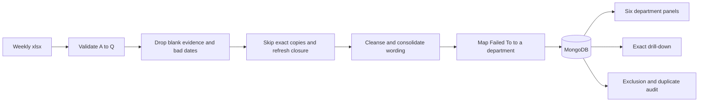

# Local executive DPU dashboard

## What the workbook actually does

The methodology in [DPU_Report_Workbook_Methodology.docx](c:\Users\Vince\Downloads\DPU_Report_Workbook_Methodology.docx) is a controlled pipeline, not a formatted report. Each row is one fault on one machine inspection. The app must keep the original evidence and add reporting fields beside it.

Reporting rules to preserve:

- **Failed Date** is the only date that places a fault in a month and week. Week commencing is the Monday of that date. A blank or placeholder fixed date does not drop the fault.
- A row is excluded only when comments, Failed To, machine area, and defect type are all empty, or when Failed Date cannot be read. Exclusions stay in an audit list with a reason.
- The inspector comment is the label. If it is blank, rebuild it from machine area plus defect type, then check text, then Failed To. Generic checks such as "Additional Findings" are not the fault.
- Equivalent wording is grouped only by approved rules, in priority order, constrained by machine area, defect type, check text, or work centre. Example: "trans oil low" becomes "Transmission oil low" only when the area is Transmission Oil. "No oil" is not the same category.
- **Failed To** is never overwritten. A separate map sends it to one of six panels: Shot and Paint, Manufacturing Facilities, Parts / POF, Production, Cab Systems, Supplier Quality. Man Eng and Design stay stored and searchable, and do not get a panel.
- Comment text must not move a fault to another department when Failed To is already filled in.
- Headline **faults per build** is faults divided by distinct build numbers in the selected period. It is not true site DPU, because machines with zero faults are missing. The footer already says this.
- For a week, trend is this week's count minus the previous week's count for the same department and cleansed fault. Share is that count divided by the department total. Share change is the difference in those shares. Red means the count or share rose, green means it fell, grey means no change, a dash means there is no previous period.
- A displayed count of 29 must open exactly those 29 source rows, with the original comment next to the cleansed label.
- Inspector and rectifier names are kept for traceability and are never ranked.

## What the raw file contains

[APR 2026 to September 2026 - Faults Data just oct test mock data.xlsx](c:\Users\Vince\Downloads\APR 2026 to September 2026 - Faults Data just oct test mock data.xlsx) is a single sheet, 15,933 rows, 17 columns. It is the raw extract only. It does not include the workbook's cleansing dictionary, department map, or executive report.

Columns match A–Q, with one source typo: column O is `faxed_date` and is the fixed date. The other fields are `order_number`, `build_number`, `serial_number`, `model`, `work_center`, `check_text`, `comments`, `failed_to`, `machine_area`, `defect_type`, `failed_by`, `failed_date`, `failed_time`, `fixed_by`, `fixed_time`, `fix`.

Profile of this file:

- Dates run 10 Jul 2026 to 20 Oct 2026, but almost everything is October: 15,896 October rows against 35 earlier rows. July, August, and September are too thin to trend.
- 1,277 machines, 61 models, 18 work centres, 49 Failed To values, 11,372 distinct comments.
- 440 comments are blank and can be recovered from machine area and defect type. No row is empty across all four evidence fields.
- 2 rows are corrupt: Failed Date is the text "Edwin Ridout" and the time columns have shifted. Those go to Excluded Records.
- 2,826 rows have no fixed date, so they stay reportable and show as open.
- Exact copies of all 17 columns: 4 extra rows. Same machine, check, comment, allocation, area, defect, and timestamp but a different other field: 5 extra rows. Dedup volume inside this file is tiny. The real risk is next week's file repeating these rows.
- Comments are a long tail. 9,491 comments appear once. The top 200 cover only 18.5% of rows. A short rule list will shape the Top 10, which is what the dashboard shows. It will not tidy every one-off sentence.

October weeks, Monday start, after a valid Failed Date:

- W/C 28 Sep: 65 October faults, 28 builds (the week crosses the month boundary)
- W/C 5 Oct: 4,859 faults, 543 builds, 8.95 per build
- W/C 12 Oct: 8,907 faults, 641 builds, 13.90 per build
- W/C 19 Oct: 2,065 faults, 258 builds, partial week through 20 Oct

The screenshot's headline for October 2026, W/C 12 Oct, is 8,894 faults, 641 builds, 13.88 per build. Unique builds match this file exactly. The fault count is 13 lower than the raw week (11 lower after dropping the two exact copies in that week). Close enough to treat the screenshot as this dataset, with a small exclusion still unexplained. Do not hard-code 8,894.

Department coverage if only the rules written in the document are applied, for that same week: Production 3,102, Cab Systems 1,291, Parts / POF 852, Manufacturing Facilities 364, Shot and Paint 317, Supplier Quality 274, hidden (Man Eng and Design) 315, and **2,392 unmapped**. Unmapped is about 28% of the file. Large gaps include Zone 1, Zone 2, Zone 7, Maintenance, axle and engine sub-assembly, Finishing Ldl, and several boom manufacturing areas. Those values are not in the methodology's mapping table. They must be mapped in the app before those faults appear on a panel. Until then they still count in the headline totals, matching the "retained but not displayed" rule.

The screenshot's lower tables repeat the rows above them, so it is the visual spec (yellow header, four KPI tiles, 2×3 Top 10 panels, red/green trend), not a verified calculation of every cell. Each panel will be calculated on its own.

## Recommended build

A local three-part app in the empty workspace [weekly dpu](C:\Users\Vince\OneDrive\Desktop\weekly dpu):

- `client`: Vite, React, TypeScript. Custom layout matched to the JCB yellow and black executive sheet, not a generic component theme.
- `server`: Node, Express, TypeScript. Parses the workbook, runs the pipeline, serves the dashboard API.
- MongoDB in Docker Compose, exposed only on localhost. One `docker compose up` plus the two dev servers. No auth, no hosting, no domain. Employee names stay on this machine and are not used in any ranking.

Aggregation is calculated when the dashboard is opened, from the stored faults. At this volume that stays exact and the drill-down cannot drift from the tile. A stored summary collection can wait.

### Upload and duplicates

The upload screen takes the weekly `.xlsx`, checks that the 17 headers are present (`faxed_date` accepted as fixed date), and shows a result: inserted, exact duplicates skipped, closure details refreshed, excluded, and rows queued for review.

Recommended duplicate rule, because a weekly re-upload of a rolling extract would otherwise double-count:

- Fingerprint every source column. If that fingerprint is already stored, skip the row and write Duplicate Audit.
- Separate event key: machine, work centre, check, comment, Failed To, machine area, defect type, failed date, and failed time. Leave fixed-by, fixed date, fixed time, and fix out of that key.
- If the event key already exists once and only the closure fields changed, update those fields in place and do not add a second fault.
- If one file contains two rows with the same event key but different source fields, keep both and list them on Operational Duplicate Review, as the methodology requires.
- Every import is a batch id on the fault, so a bad file can be identified. Re-uploading the same file is a no-op.

The alternative, if the weekly file is only new rows and closure changes should count as extra evidence, is to skip exact fingerprints and never update in place. That matches section 8 of the methodology more literally and will inflate the dashboard if the extract is cumulative.

Replacing the whole database from each file is the third option. It is simple and wrong for audit, and a partial file would wipe history.

### Cleansing and mapping

Store a versioned rule set in Mongo and stamp that version on every fault at import.

Seed text rules from section 7.2 of the methodology (rolling road, rear axle pivot, boom wax oil, transmission oil high and low, slaved wheels, rear door fouling versus lock, fender, harness, steps out of line, dizzy ram pin, and the other listed examples), plus the generic steps: case and punctuation, approved abbreviations (`inop` to `inoperative`), and single-word comments expanded with machine area and defect type.

Seed department rules that the document does state: Materials and Logistics to Parts / POF, Cab Systems, Supplier Quality, Zones 3–6 and Boom Sub Assembly to Production, Shot and Paint, Finishing Ldl only when defect type contains paint, chassis and machining and fabrication manufacturing to Manufacturing Facilities, Man Eng and Design hidden.

Do not guess the other Failed To values into Production. A mapping screen lists every unmapped value with its fault count so you can assign it once. Changing a map or a consolidation rule re-derives the reporting fields. It does not rewrite the original comments.

A second idea, rejected as the default: fuzzy-clustering the 11,000 comments. That will mis-group executive numbers. Similar-comment suggestions can come later as a review queue that never auto-applies.

A third idea: you keep maintaining the dictionary in Excel and upload it with the faults. Use that only if you still have the real workbook sheets (`Department Mapping` and `Methodology / Cleansing Dictionary`). This extract does not contain them.

### Dashboard

One screen matching the mock:

- Month selector, then weeks that contain faults in that month, plus All weeks. Choosing All weeks labels the view as monthly and compares with the previous month. A single week compares with the previous calendar week.
- Tiles: total faults, unique builds, faults per build, period status.
- Six panels in the screenshot order, Top 10 by count, columns for count, trend, current share, and share change.
- Clicking a row opens the exact source records: original comment, cleansed fault, Failed To, model, build, serial, work centre, dates, and closure. No inspector league table.
- Upload, import history, unmapped Failed To, rule editor, and the three audit lists sit off the executive page.

### API shape

- `POST /api/imports` multipart workbook
- `GET /api/periods` months and their weeks
- `GET /api/dashboard?month=&week=` tiles plus six Top 10s
- `GET /api/faults` drill-down with the same period, department, and cleansed fault
- `GET/PUT /api/mappings` and `/api/rules`
- `GET /api/audits/excluded|duplicates|operational`

### Fault document

Source fields stored unchanged, plus `rowHash`, `eventKey`, `importBatchId`, `cleansedFault`, `executiveDepartment`, `month`, `weekCommencing`, `closureStatus`, `ruleVersion`, and `exclusionReason` when excluded. Indexes on `rowHash` (unique), `eventKey`, `failedDate`, and `executiveDepartment + weekCommencing + cleansedFault`.

Excluded rows and duplicate audit rows live in their own collections so the dashboard query is only the reportable set.

## What this will not do in the first version

- True site DPU. That needs a separate build-count feed of machines with no faults. The tile keeps the methodology's fault-extract definition and the footnote.
- Ranking people.
- A public deployment.

## Implementation order

1. Scaffold client, server, and Docker Compose, and confirm Mongo is reachable locally.
2. Import the sample workbook, persist raw rows, and implement the duplicate and exclusion rules. Check the W/C 12 Oct import against 641 builds and about 8,900 faults.
3. Seed cleansing and the known department map. Recompute derived fields.
4. Build the dashboard API and the executive screen, including previous-period trend and share.
5. Add drill-down and confirm a panel count equals the opened row count.
6. Add the mapping screen, rule editor, and audit pages so unmapped Failed To values and new wording can be classified without a code change.

