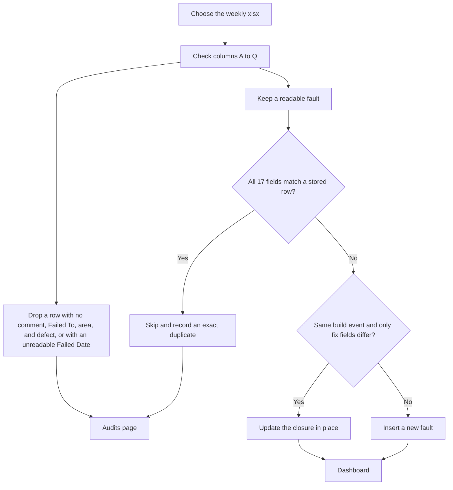

# Weekly upload

Use the Upload page. The file must be `.xlsx` with the header row described in [04-column-specification.md](04-column-specification.md).

## What the import does

Uploading the same file again does not increase the fault counts. The duplicate audit records the skip.

If the same event comes back and only `fixed_by`, `faxed_date`, `fixed_time`, or `fix` changed, the stored row is updated and the fault is not counted twice. The event match also requires the model and the person who recorded it to be the same, and there must be only one stored row for that event.

If the same event key differs on a field that is not a closure field, both rows are kept and an operational review is recorded.

## Mock file

`samples/mock-faults-jan-2026-to-date.xlsx` has 2,394 rows. Failed dates run from 1 January 2026 through 26 October 2026. Build numbers start with `MOCK-`. The inspectors are fictional. A few rows are exact copies of earlier rows, and one row has Failed Date `not-a-date` so the exclusion audit has something to show. Some rows have a fix date so a second save of the same file can exercise a closure refresh only if you change those fix fields first. Uploading the file unchanged is an exact-duplicate skip.

Do not upload this file into the database that already holds the real extract unless you mean the mock faults to appear on the dashboard beside the real ones. For a clean test, point `MONGO_DB` at a different database name before starting the API, upload the mock file there, and switch back when you are finished.

## After the upload

The Upload page and the API window both report:

- inserted
- exact duplicates skipped
- closure refreshed
- excluded
- operational reviews

Open Audits for the row-level lists. Open the dashboard and pick the month and week you expect to see.
