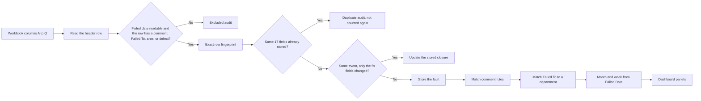
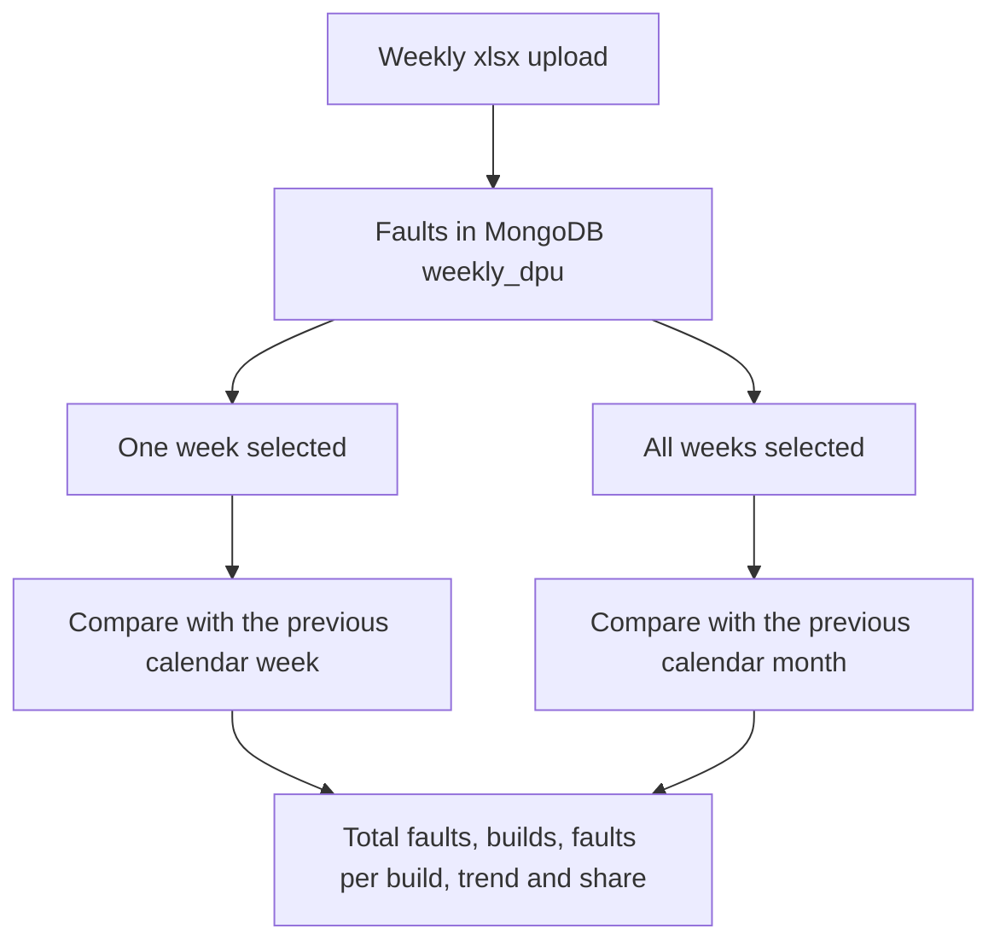

# Build Quality | Executive DPU Review

A local review of build faults. Each week an Excel extract is uploaded. The app stores the rows, skips exact copies, cleans the inspector comments into repeatable fault names, and places each fault on one of six executive panels. The dashboard shows how many faults were recorded, how many builds they sit on, and whether each fault is up or down against the previous week or the previous month.

DPU here means faults per build: recorded faults divided by the distinct build numbers in the extract. A machine that had no fault in the file is not in that count.

This runs on one PC. It is not hosted, it has no login, and it does not rank inspectors. Names are kept so a fault can be traced back to the person who recorded it.

## Look and feel

The page is a JCB themed dashboard. It opens in dark mode, and the sun and moon button in the header switches between Dark, Light, and System. The choice is remembered in the browser.

- Built with React, Tailwind CSS v4, and shadcn/ui components, with Recharts for the charts.
- Two React Bits components are copied in: a count-up for the headline figures and a spotlight hover on the figure cards.
- Fonts are bundled with the app, so no internet connection is needed at run time.
- The dashboard has a chart row (faults by department, share of mapped faults, and the last eight weeks by department) above the six ranked panels. Selecting a bar, a donut slice, a legend name, or a point on the weekly lines opens the source records for that department. A point narrows the records to that week.

## What you can do

- Upload the weekly faults workbook from the Upload page.
- Read the six panels for a month, a single week, or every week in the month.
- Open a fault count and see the original comment beside the cleansed name, plus who recorded it.
- Map a Failed To value onto an executive department, or hide it.
- Edit the comment rules that group the same fault written in different words.
- Review rows that were excluded, skipped as exact duplicates, or kept aside for an operational check.

## The six panels

| Panel | Typical Failed To values |
| --- | --- |
| Shot & Paint | Shot & Paint, and Finishing Ldl only when the defect type contains paint |
| Manufacturing Facilities | Chassis Manufacturing, Machining Manufacturing, Fabrication Manufacturing |
| Parts / POF | Materials, Logistics |
| Production | Zone 3, Zone 4, Zone 5, Zone 6, Boom Sub Assembly |
| Cab Systems | Cab Systems |
| Supplier Quality | Supplier Quality |

Man Eng and Design are stored and kept off the panels. Any other Failed To stays in the headline total and off the panels until someone maps it. The app does not guess those into Production.

## How a row becomes a panel count



Failed Date is column L, `failed_date`. The month is `YYYY-MM` from that date. The week is the Monday of that date. Column Q `fix` and column O `faxed_date` do not choose the month, the week, the department, or the count. A blank fix date, or the placeholder `2020-01-01`, shows as Open in the drill-down. Any other fix date shows as Fixed.



A week that crosses a month boundary is listed under both months, but each month only counts the days whose Failed Date falls in that month. The comparison for a chosen week is the whole previous week, including days that fall in the other month.

Each panel row shows the previous period quantity beside the current quantity. The column reads Prev week QTY in the weekly view and Prev month QTY in the monthly view. Share change is the department share for the period minus its share in the previous period, using every mapped fault in that department and not only the top 10. Red means the count or share went up. Green means it went down. Grey means it did not change. A dash means the previous period had no faults to compare.

## Repository

```text
weekly dpu/
  frontend/     React page (Tailwind v4, shadcn/ui, Recharts). Vite serves it on port 5173 and proxies /api to port 4000.
                src/components/ui holds the shadcn components, src/components/reactbits the React Bits ones,
                src/theme.tsx the dark and light switch.
  backend/      Express API on port 4000. Parses workbooks and reads MongoDB.
  samples/      Mock workbook for an upload test.
  DOC/          Setup guide, start and stop, upload, mapping, and column notes.
  start-dpu.bat Opens the API window and the page window.
  stop-dpu.bat  Stops those two processes. Leaves MongoDB running.
```

MongoDB is a separate program. This app expects it on `mongodb://127.0.0.1:27017`, database `weekly_dpu`.

## Run it

MongoDB must already be listening on port 27017.

From the project folder, double-click `start-dpu.bat`, or follow [DOC/00-start-and-stop.md](DOC/00-start-and-stop.md) and start the two processes by hand. Then open http://127.0.0.1:5173.

The API window prints the Windows account that started it, the PC name, each request, and a one-line summary after every upload. There is no login, so that window cannot show a signed-in user.

Putting the app on another PC is described in [DOC/01-setup-guide.md](DOC/01-setup-guide.md).

## Further reading

- [Start and stop](DOC/00-start-and-stop.md)
- [Setup on another PC](DOC/01-setup-guide.md)
- [Weekly upload](DOC/02-upload-sop.md)
- [Mapping and rules](DOC/03-mapping-and-rules-sop.md)
- [Column specification](DOC/04-column-specification.md)
- [How this review was built](DOC/05-project-history.md)
