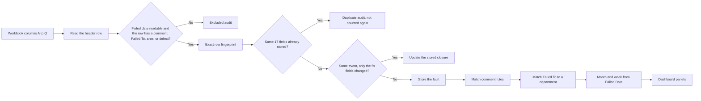
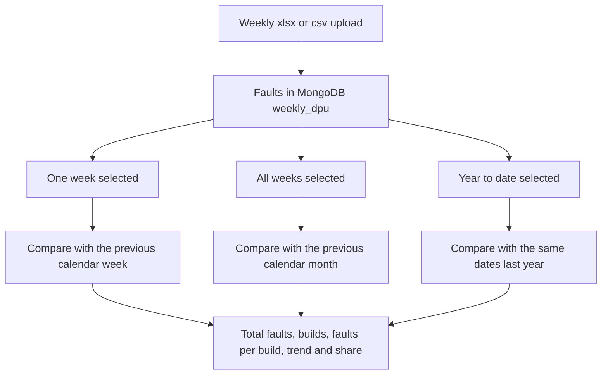

# Build Quality | Executive DPU Review

A local review of build faults. Each week an Excel extract is uploaded. The app stores the rows, skips exact copies, cleans the inspector comments into repeatable fault names, and places each fault on one of six executive panels. The dashboard shows how many faults were recorded, how many builds they sit on, and whether each fault is up or down against the previous week or the previous month.

DPU here means faults per build: recorded faults divided by the distinct build numbers in the extract. A machine that had no fault in the file is not in that count.

This runs on one PC. It is not hosted, it has no login, and it does not rank inspectors. Names are kept so a fault can be traced back to the person who recorded it.

## Look and feel

The page is a JCB themed dashboard. It opens in dark mode, and the sun and moon button in the header switches between Dark, Light, and System. The choice is remembered in the browser.

- Built with React, Tailwind CSS v4, and shadcn/ui components, with Recharts for the charts.
- Two React Bits components are copied in: a count-up for the headline figures and a spotlight hover on the figure cards.
- The header carries the official JCB logo from `frontend/public/jcb-logo.png`. Replace that file to change it.
- Fonts are bundled with the app, so no internet connection is needed at run time.
- The dashboard has a chart row (faults by department, share of mapped faults, and the last eight working weeks by department) above the six ranked panels. Selecting a bar, a donut slice, a legend name, or a point on the weekly lines opens the source records for that department. A point narrows the records to that week.

## What you can do

- Upload the weekly faults extract from the Upload page, as an `.xlsx` workbook or a `.csv` file with the same 17 columns.
- Pick a year, then read the six panels for a month, a single week, every week in the month, or the whole year (the Year to date button beside the Week filter).
- Say which weeks production was shut, so the weekly trend charts leave them out (the Shutdown weeks card on the Rules page).
- Open a fault count and see the original comment beside the cleansed name, plus who recorded it.
- Open Analytics to look at the same faults from other angles: patterns in the recorded fields, the cleansed faults, and a pick-a-chart explorer. See the Analytics section below.
- Map a Failed To value onto an executive department, or hide it.
- Edit the comment rules that group the same fault written in different words.
- Review rows that were excluded, skipped as exact duplicates, or kept aside for an operational check.

## The six panels

| Panel | Typical Failed To values |
| --- | --- |
| Shot & Paint | Shot & Paint, and Finishing Ldl when the defect type contains paint |
| Manufacturing Facilities | Chassis, Machining and Fabrication Manufacturing, plus the other manufacturing, fabrication and Maintenance values |
| Parts / POF | Materials, Logistics, Boom Kitting |
| Production | The zones, the sub assemblies, and the line, test and rectification stages |
| Cab Systems | Cab Systems |
| Supplier Quality | Supplier Quality |

Man Eng and Design are stored and kept off the panels. Any other Failed To stays in the headline total and off the panels until someone maps it. The app does not guess those into Production.

## How a row becomes a panel count



Failed Date is column L, `failed_date`. The month is `YYYY-MM` from that date. The week is the Monday of that date. Column Q `fix` and column O `faxed_date` do not choose the month, the week, the department, or the count. A blank fix date, or the placeholder `2020-01-01`, shows as Open in the drill-down. Any other fix date shows as Fixed.



Year to date runs from 1 January of the year of the newest fault to that fault, by Failed Date. It is compared with the same calendar days of the year before. When no faults exist for those days, the trend badges show No comparison. Month and Week are not used in this view.

The Year filter is the first selector. It lists every year that has faults, newest first, and the Month list shows only the months of the chosen year. The newest year opens by default, so when the first faults of a new year are uploaded the Dashboard starts that year with its own empty trend chart. Earlier years stay available in the Year filter, and their button reads Full year instead of Year to date.

Shutdown weeks are weeks when production was shut. 2026 starts with the weeks commencing 25 May (Spring Bank Holiday and Whitsun), 20 July, 27 July and 3 August (summer), 28 September (autumn) and 28 December (Christmas). 2027 adds the weeks commencing 26 July, 2 August and 9 August (summer), 27 September (autumn) and 27 December (Christmas). Only shutdowns of five days or more are listed, so single bank holidays and the four-day Whitsun shutdown in 2027 (1 to 4 June) are not. The weekly trend chart on the Dashboard and the Week commencing breakdown in the Analytics Explorer leave these weeks out, and the chart notes which ones. The trend chart also only holds weeks that commence in the selected year. Totals, panels, the comparison with the previous week, drill-downs and the other Analytics charts still count every fault. A shutdown week can still be picked in the Week filter, where it is labelled. Each year's list is added once the first time the API starts, so a week removed on the Rules page stays removed. Add later years' weeks on the Rules page ahead of time.

A week that crosses a month boundary is listed under both months, but each month only counts the days whose Failed Date falls in that month. The comparison for a chosen week is the whole previous week, including days that fall in the other month.

Each panel row shows the previous period quantity beside the current quantity. The column reads Prev week QTY in the weekly view, Prev month QTY in the monthly view and Prev year QTY in the year to date view. Share change is the department share for the period minus its share in the previous period, using every mapped fault in that department and not only the top 10. Red means the count or share went up. Green means it went down. Grey means it did not change. A dash means the previous period had no faults to compare.

## Analytics

The Analytics page sits beside the Dashboard. A filter bar at the top sets the date range (last 4 weeks, last 8 weeks, this month, all data, or custom), a department, a model and a work centre. The range counts back from the newest Failed Date in the data and not from today. The filters are in the address, so a view can be bookmarked.

| Tab | What it shows |
| --- | --- |
| Patterns | Recorded fields as they came in: a machine area against defect type heatmap, faults by hour and weekday, a model league with faults per build, the defect-type mix and the work-centre load, each split by department. |
| Faults | Processed data: a Pareto of the top cleansed faults, fault movement (4 weeks against the 4 before) per department, Failed To against department, and how many faults were named by a cleansing rule. |
| Explorer | Choose a measure (faults, distinct builds, faults per build) and a breakdown (department, model, machine area, defect type, work centre, Failed To, hour, weekday, week, month). |

Selecting any chart mark opens the records behind it in the same side sheet as the Dashboard. Nothing on this page ranks or names inspectors, and the recorded-by column stays inside the record sheet. Faults per build is marked low volume where a group has fewer than 5 builds.

## Repository

```text
weekly dpu/
  frontend/     React page (Tailwind v4, shadcn/ui, Recharts). Vite serves it on port 3124 and proxies /api to port 4213.
                src/components/ui holds the shadcn components, src/components/reactbits the React Bits ones,
                src/theme.tsx the dark and light switch.
  backend/      Express API on port 4213. Parses the .csv and .xlsx faults extracts and reads MongoDB.
                src/analytics.ts holds the read-only Analytics aggregations.
  samples/      Mock faults extract as .csv and .xlsx for an upload test.
  DOC/          Setup guide, start and stop, upload, mapping, and column notes.
  start-dpu.bat Opens the API window and the page window.
  stop-dpu.bat  Stops those two processes. Leaves MongoDB running.
```

MongoDB is a separate program, which you install once. This app expects it on `mongodb://127.0.0.1:27017`, database `weekly_dpu`.

## Run it

`start-dpu.bat` starts MongoDB for you if it is not already listening on port 27017.

From the project folder, double-click `start-dpu.bat` (it asks for Dev or Production; `start-dpu-dev.bat` and `start-dpu-prod.bat` skip the question), or follow [DOC/00-start-and-stop.md](DOC/00-start-and-stop.md) and start the two processes by hand. Then open http://127.0.0.1:3124. The start script and both servers also print a Network address, for example http://192.168.1.20:3124, which other people on the same network can open. The page is not password protected, so only start it on a network you trust.

The API window prints the Windows account that started it, the PC name, each request, and a one-line summary after every upload. There is no login, so that window cannot show a signed-in user.

Putting the app on another PC is described in [DOC/01-setup-guide.md](DOC/01-setup-guide.md).

## Further reading

- [Start and stop](DOC/00-start-and-stop.md)
- [Setup on another PC](DOC/01-setup-guide.md)
- [Weekly upload](DOC/02-upload-sop.md)
- [Mapping and rules](DOC/03-mapping-and-rules-sop.md)
- [Column specification](DOC/04-column-specification.md)
- [How this review was built](DOC/05-project-history.md)
